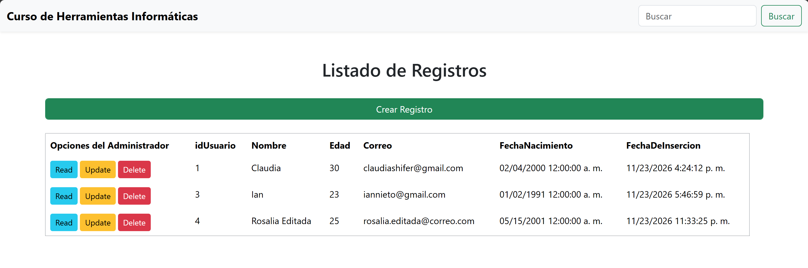
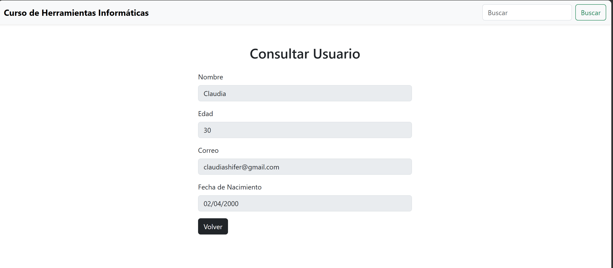
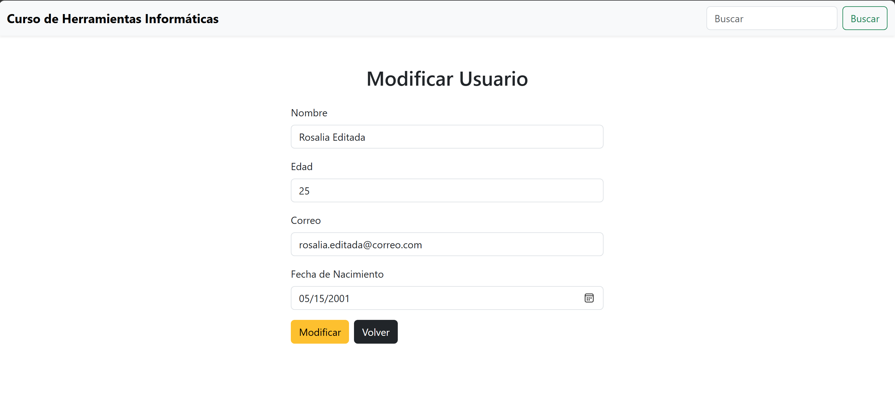
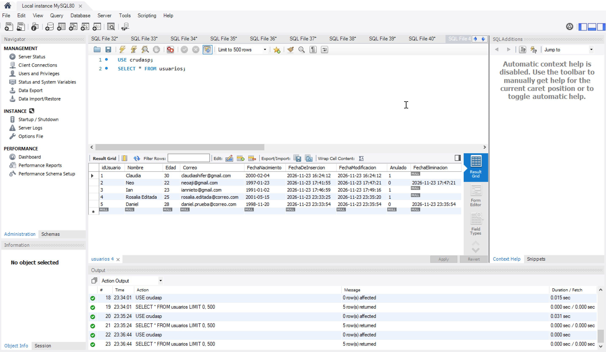

# Laboratorio-9-ASP.NET
# Módulo II — Aplicación Web CRUD en ASP.NET Web Forms y MySQL
> **📅 Fecha:** 23/11/2026

## 📋 Contenido y Propósito
Aplicación web CRUD (Crear, Leer, Actualizar y Eliminar) desarrollada con **ASP.NET Web Forms**, **C#**, **Bootstrap 5** y **MySQL** para la gestión de registros en la tabla `usuarios` de la base de datos `crudasp`[cite: 1].

El sistema utiliza una página maestra (`MP.Master`) con barra de navegación y diseño responsivo con Bootstrap 5, junto con las vistas `Index.aspx` (listado de registros activos y eliminación lógica) y `CRUD.aspx` (creación, consulta en modo solo lectura y modificación de registros mediante parámetros por `QueryString`). A nivel de base de datos, implementa procedimientos almacenados (`sp_load`, `sp_read`, `insert_user`, `sp_update`, `sp_delete`), auditoría de fechas (`FechaDeInsercion`, `FechaModificacion`, `FechaEliminacion`) y borrado lógico mediante el campo `Anulado`.

## 🛠️ Tecnologías y Autor
- **Tecnologías:**
  - C# y ASP.NET Web Forms (.NET Framework)
  - HTML5, CSS3 y Bootstrap 5 (CDN)
  - MySQL (`crudasp`) y `MySql.Data`
- **Autor:** Neo Aji, Gabriel Jimenez, Justin Okada
- **Institución:** Universidad Tecnológica de Panamá (UTP) — Facultad de Ingeniería de Sistemas Computacionales
- **Contexto:** Curso de Herramientas de Programación III / Módulo II: Lenguajes multiplataforma: ASP.NET

## 🖼️ Capturas y Problemas
### Ejercicios / Operaciones Implementadas
- **CREATE:** Creación de nuevos registros de usuario desde `CRUD.aspx` (`op=C`) mediante el procedimiento `insert_user`.
- **READ:** Visualización del listado de usuarios activos en `Index.aspx` (`sp_load`) y consulta detallada de un usuario (`op=R` y `sp_read`).
- **UPDATE:** Modificación de datos de un usuario existente desde `CRUD.aspx` (`op=U`) ejecutando `sp_update` y actualizando `FechaModificacion`.
- **DELETE:** Eliminación lógica desde `Index.aspx` mediante `sp_delete` (`Anulado = 0` y registro de `FechaEliminacion`).

### Evidencia Visual (Capturas)
- `Index.aspx` — Listado de registros activos y opciones del administrador (`Read`, `Update`, `Delete`).
  
- `CRUD.aspx` — Formulario de creación / consulta / edición de usuario.
  
  
- MySQL Workbench — Tabla `usuarios` verificando inserción, actualización y borrado lógico (`Anulado = 0`).
  

## 🗂️ Estructura de Directorios
```text
CRUD/
├── Pages/
│   ├── CRUD.aspx
│   ├── CRUD.aspx.cs
│   ├── Index.aspx
│   └── Index.aspx.cs
├── MP.Master
├── MP.Master.cs
├── Web.config
├── packages.config
└── README.md
